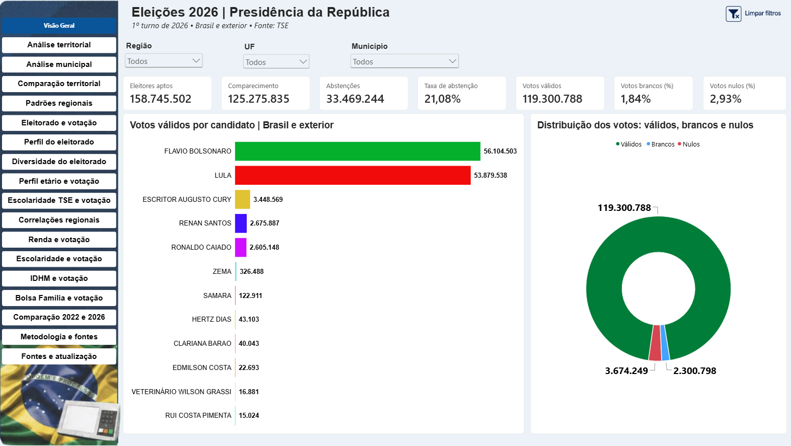
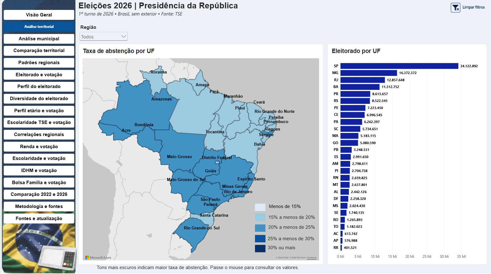
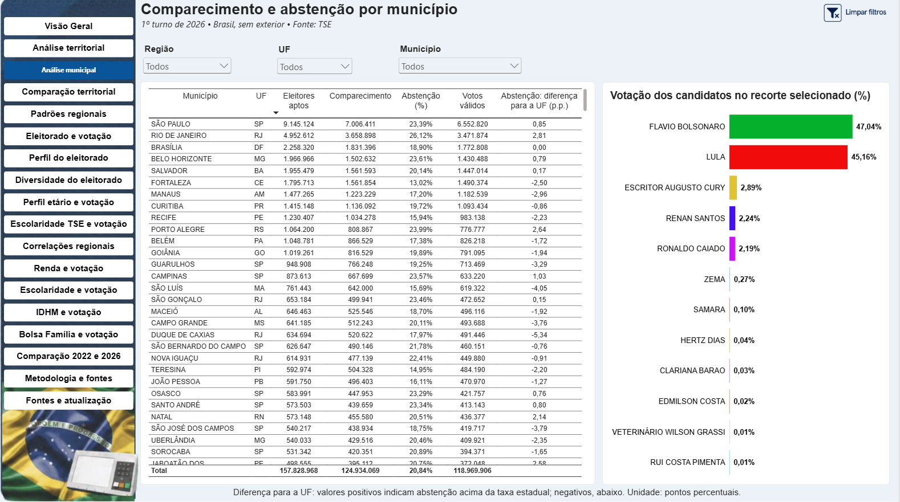
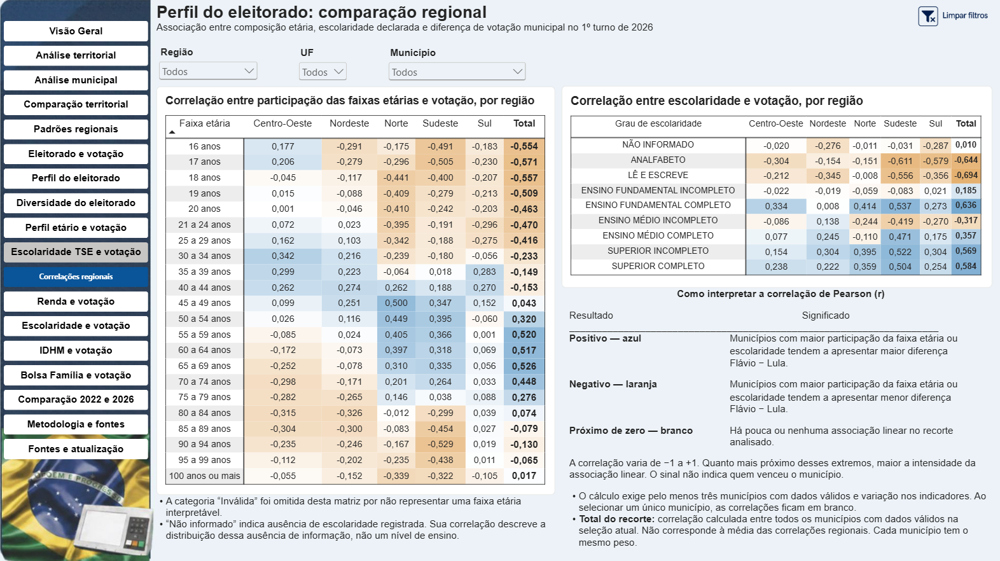
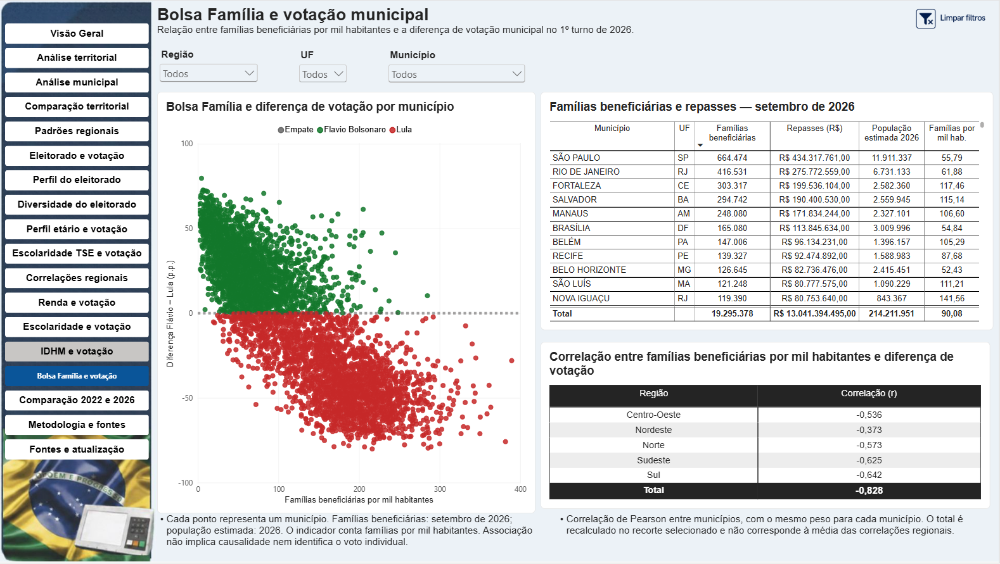

# Eleições presidenciais de 2026: análise territorial e perfil do eleitorado

Projeto de análise exploratória desenvolvido por **Liliane Rose Refatti**, utilizando Power BI, dados eleitorais do TSE e indicadores municipais de fontes públicas.

O relatório explora a distribuição territorial da votação no primeiro turno de 2026, o perfil do eleitorado e as associações entre resultados municipais e indicadores socioeconômicos. Também apresenta uma comparação com o primeiro turno de 2022, considerando limitações de comparabilidade territorial.

🔗 **[Acessar o dashboard interativo](https://app.powerbi.com/view?r=eyJrIjoiMWVkYzVjYWQtNDViNy00ZjM1LWJmMDgtZDI2YmI3OGJjMWUxIiwidCI6IjYwMjcxMGYzLTAyNGYtNGQ2YS1hZDQ4LTM3OTkwZTU4MzUwMCJ9)**

## Prévia do dashboard

### Visão geral

### Análise territorial

### Análise municipal

### Correlações regionais

### Bolsa Família e votação

## Objetivo

Investigar como a votação varia entre municípios, estados e regiões e como essas diferenças se relacionam com o tamanho do eleitorado, a composição demográfica e os indicadores municipais.

O projeto também demonstra etapas de preparação de dados, modelagem, construção de medidas, validação e comunicação dos resultados em um relatório interativo.

## Perguntas exploradas

- Como a votação dos candidatos se distribui pelo território?
- Onde cada um dos dois candidatos comparados ficou à frente e qual foi a diferença?
- Como os resultados variam conforme o tamanho do eleitorado?
- Quais padrões aparecem nas diferentes regiões?
- Como renda, escolaridade, IDHM e presença do Bolsa Família se associam à diferença de votação municipal?
- Como os percentuais de votação se modificaram entre os primeiros turnos de 2022 e 2026?

## Ferramentas utilizadas

- **Power BI Desktop:** modelagem e desenvolvimento das visualizações.
- **Power Query:** importação, limpeza, transformação e integração das bases.
- **DAX:** indicadores, percentuais, diferenças em pontos percentuais e correlações.
- **Power BI Service:** publicação e acesso ao relatório.

## Preparação e modelagem dos dados

O desenvolvimento incluiu:

- Filtragem das bases eleitorais para presidente e primeiro turno.
- Padronização dos campos e tipos de dados.
- Construção de uma dimensão de localidades para conectar as bases.
- Integração de coordenadas municipais para posicionamento no mapa.
- Organização dos relacionamentos entre dimensões e tabelas de fatos.
- Integração de indicadores municipais de diferentes fontes e anos.
- Tratamento de informações ausentes e identificação de situações que exigem revisão territorial.
- Conferência de totais, filtros, interações e dicas de ferramenta.

## Análises disponíveis

| Eixo | Conteúdo |
|---|---|
| Resultados eleitorais | Votos, participação, abstenção e distribuição territorial |
| Análise municipal | Diferenças de votação e comparação entre localidades |
| Tamanho do eleitorado | Relação entre eleitores aptos e resultados municipais |
| Perfil do eleitorado | Faixa etária, escolaridade e gênero |
| Diversidade | Raça/cor, identidade de gênero, informação quilombola e estado civil |
| Indicadores municipais | Renda, escolaridade, IDHM e Bolsa Família |
| Correlações regionais | Associações entre composição do eleitorado e diferença de votação |
| Comparação histórica | Resultados dos primeiros turnos de 2022 e 2026 |

## Critérios de análise

### Percentuais e diferenças

Os percentuais de votação utilizam os votos válidos do respectivo ano e recorte geográfico.

A diferença entre Flávio e Lula é apresentada em pontos percentuais:

**Diferença = 100 × (percentual de Flávio − percentual de Lula)**

Valores positivos indicam vantagem de Flávio; valores negativos indicam vantagem de Lula, entre os dois candidatos comparados.

Os resultados agregados são calculados a partir dos totais de votos, e não pela média simples dos percentuais municipais.

### Correlações

As correlações de Pearson utilizam municípios com dados válidos nas duas variáveis analisadas. Cada município tem o mesmo peso nesse cálculo.

O resultado do recorte agregado é recalculado com os municípios disponíveis e não corresponde à média das correlações regionais.

**Correlação não demonstra causalidade.** Uma associação observada entre municípios não permite concluir como pessoas de determinada idade, escolaridade ou condição socioeconômica votaram.

### Cobertura geográfica

A visão geral contempla Brasil e exterior. As análises territoriais municipais, de perfil, de indicadores e de comparação histórica consideram o Brasil, excluindo registros do exterior.

### Comparação entre 2022 e 2026

A comparação considera o primeiro turno das duas eleições.

A variação de Lula compara seus percentuais entre os anos. A comparação entre Flávio em 2026 e Jair Bolsonaro em 2022 envolve candidatos diferentes e deve ser interpretada dessa forma.

As variações municipais são suspensas nos recortes identificados com revisão territorial pendente.

## Fontes e períodos de referência

| Base | Fonte | Referência |
|---|---|---|
| Resultados eleitorais | TSE | Primeiros turnos de 2022 e 2026 |
| Perfil do eleitorado | TSE | Base de 2026 |
| Renda domiciliar mensal per capita | IBGE, Censo Demográfico | 2022 |
| Escolaridade da população de 25 anos ou mais | IBGE, Censo Demográfico | 2022 |
| IDHM | Atlas do Desenvolvimento Humano, PNUD/Ipea/FJP | 2010 |
| Famílias beneficiárias do Bolsa Família | MDS, VIS DATA | Setembro de 2026 |
| Estimativas populacionais | IBGE | 2026 |

Os links específicos e as datas de geração disponíveis estão documentados na página **Metodologia e fontes** do dashboard.

## Limitações

- Os indicadores possuem anos de referência diferentes e não representam um retrato simultâneo dos municípios.
- Dados ausentes são tratados como ausência de informação, sem substituição automática por zero.
- Categorias não informadas limitam a interpretação de alguns atributos do eleitorado.
- O perfil do eleitorado cadastrado não corresponde necessariamente ao perfil das pessoas que compareceram à votação.
- A quantidade de municípios com dados válidos pode variar entre indicadores e categorias.
- O indicador do Bolsa Família representa **famílias beneficiárias por mil habitantes**, não o percentual de pessoas beneficiárias.
- A análise é descritiva e exploratória, sem pretensão de explicar individualmente o comportamento eleitoral.

## Autoria

**Liliane Rose Refatti**

Projeto de portfólio em análise de dados e Business Intelligence.
